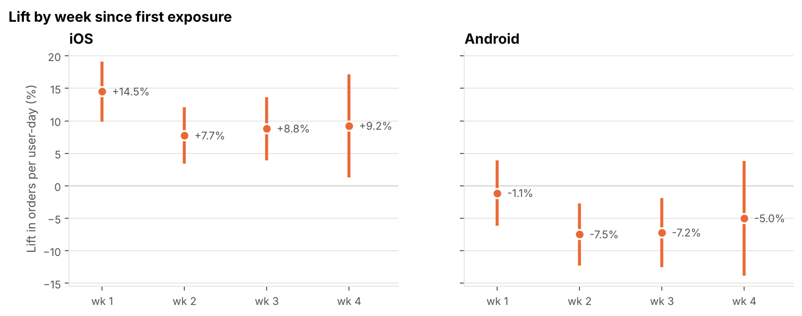
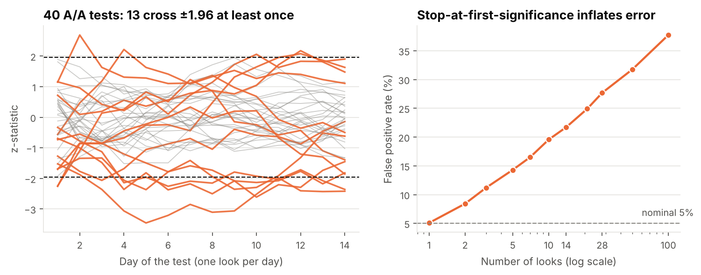
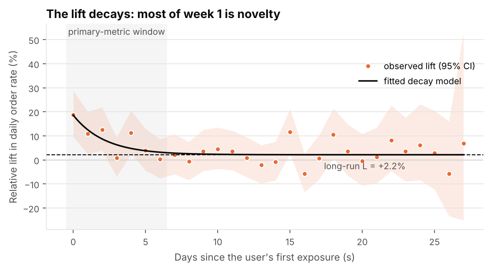
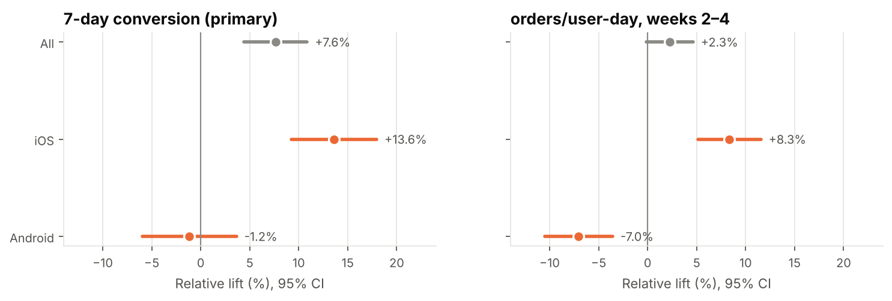

# 🍕 Pizza delivery app: an A/B test, end to end

A pizza delivery app redesigns its menu page (big photo cards + a *Popular near you* row) and
A/B tests it on 125k users. The headline result is a significant **+7.6%** lift in conversion.

**The right decision is still not "ship it".** This repo walks through why, the way an
experiment should actually be run: power analysis before launch, a pre-registered analysis,
then the three traps that would have led to the wrong call.

> **Decision: ship on iOS, don't ship on Android.** Most of the +7.6% is a novelty effect: measured as
> orders per user-day, the lift is +8.2% in users' first week but +2.3% in weeks 2–4 (not significant).
> That +2.3% blend hides **+8.3% on iOS** and **−7.0% on Android**, where the new page loads 0.9 s slower.
> → [decision memo](reports/decision_memo.md)



## The notebooks

| # | Notebook | Question | Key technique |
|---|---|---|---|
| 01 | [Power analysis](notebooks/01_power_analysis.ipynb) | How many users, for how long? | Sample size for proportions, MDE as a business choice, whole-week runtime, simulation-based power check, CUPED for planning, pre-registration |
| 02 | [A/B analysis](notebooks/02_ab_analysis.ipynb) | What did the test show at day 21? | SRM check, covariate balance, two-proportion test, CUPED, delta method for ratio metrics, guardrails with bootstrap CIs |
| 03 | [Trap 1: peeking](notebooks/03_peeking.ipynb) | What if we'd looked early? | False-positive inflation by number of looks, O'Brien-Fleming boundaries, mSPRT always-valid p-values, winner's curse |
| 04 | [Trap 2: novelty](notebooks/04_novelty_effect.ipynb) | Will the effect last? | Lift by days since exposure, decay-model fit with user-level bootstrap CIs, fixed-cohort check, user-clustered ratio metrics |
| 05 | [Trap 3: segment reversal](notebooks/05_segment_reversal.ipynb) | Is it good for everyone? | Pre-registered segments, interaction tests, mechanism check, Simpson's paradox vs heterogeneity, Holm correction, Cochran's Q |
| 06 | [Decision](notebooks/06_decision.ipynb) | Ship or don't ship? | Pre-registered ship rule, impact sizing with CIs, recovery of the true parameters, decision rules tested on 100 re-runs |

## What each trap looks like

**Peeking.** The live dashboard hit p < 0.05 on **day 1**, showing +24%. Stopping at the first
significant look over 14 daily checks gives a ~22% false-positive rate instead of 5%.



**Novelty.** Users react to anything new. The daily lift starts near +19% on day 0 and settles
around +2% from week 2 on. A 7-day primary metric measures mostly curiosity.



**Segment reversal.** Positive on average, negative on Android. The failed load-time guardrail is the
likely explanation, but it isn't proven: load time wasn't randomized, so an Android re-test is the causal check. Region, which was *not* pre-registered, shows two "significant" regions that vanish
after multiple-testing correction.



## Interview topics covered

* Choosing a primary metric; unit of randomization vs unit of analysis
* Power, MDE, sample size, runtime; why "observed power" is meaningless
* SRM and A/A checks
* Guardrails as non-inferiority tests, and why they need power too
* Two-proportion z-test, Welch test, CIs for relative lift (delta method)
* Variance reduction with CUPED, and when it doesn't help
* Ratio metrics and user-level clustering
* Peeking, sequential testing (group sequential and always-valid)
* Novelty vs primacy (change aversion) effects
* Heterogeneous treatment effects, interaction tests, multiple comparisons
* Simpson's paradox (and why a split that is constant across strata can't produce it)
* Turning results into a decision with explicit trade-offs

## Run it

```bash
git clone <this repo> && cd pizza-ab-test
python -m venv .venv && source .venv/bin/activate
pip install -e ".[dev]"
make all        # generate data, execute all notebooks, run tests
```

`make data` writes the CSVs to `data/` (≈ 11 MB, git-ignored). Notebooks generate it on first run
if it's missing. Everything is seeded, so results reproduce exactly.

## Repository layout

```
src/pizza_ab/
  config.py      experiment design + the simulator's hidden ground truth
  simulate.py    synthetic users and orders (hash-based assignment, weekday seasonality,
                 user heterogeneity, novelty decay, platform-specific effects)
  metrics.py     user-level and exposure-day metric tables
  stats.py       power, tests, delta method, CUPED, SRM, Holm, O'Brien-Fleming, mSPRT
  novelty.py     lift by days-since-exposure and the decay-model fit
  plots.py       shared chart style
notebooks/       01–06, executed with outputs
reports/         decision memo + figures
scripts/         seed_scan.py: where the main seed sits among 40 seeds
tests/           pytest suite (stats functions cross-checked against statsmodels)
```

## About the data

The data is **simulated**. That is a limitation and a feature. Limitation: real data is messier —
bots, logging gaps, users on several devices, effects that drift with promotions. Feature: the true
effects are known (`config.TRUTH`), so notebook 06 can check that the methods recover them, and can
re-run the whole experiment 100 times to test the decision rule itself.

The analysis notebooks (01–05) never read `TRUTH`. To be upfront, though: the same person wrote the
simulator and the pre-registration. The platform hypothesis in notebook 01 is a narrative device. It
shows how a pre-registered segment *should* be justified, but it was not a blind prediction.

The main experiment uses `seed=22`. In a 40-seed scan (`scripts/seed_scan.py`) it sits at the median
for the blended weeks 2–4 effect, but it shows a slightly larger-than-typical platform reversal
(iOS +8.3% and Android −7.0%, vs medians of +7.7% and −6.4%). Notebook 06 re-runs the whole
experiment 100 times to check that the decision doesn't depend on the seed.

Planted ground truth, for the curious: post-novelty effect +7% on iOS and −6% on Android, a +12%
novelty boost decaying with τ = 3.5 days, +0.9 s Android load time, no true regional differences, no
true AOV effect.
